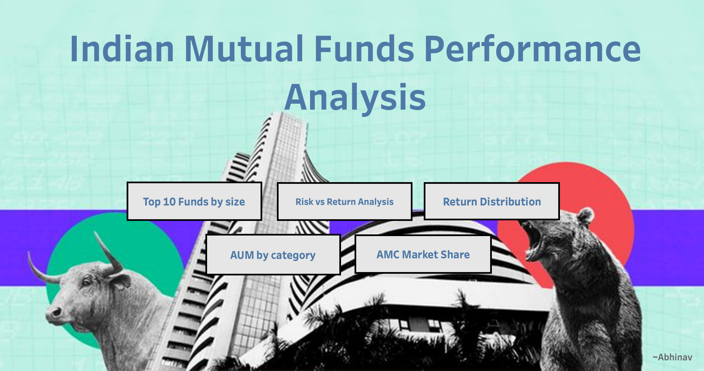
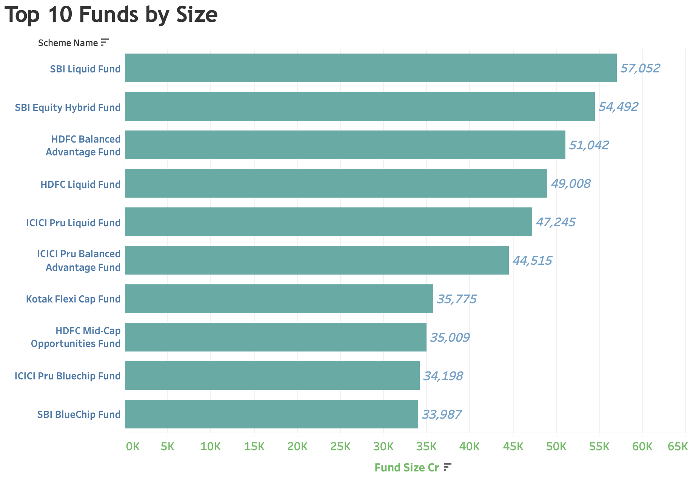
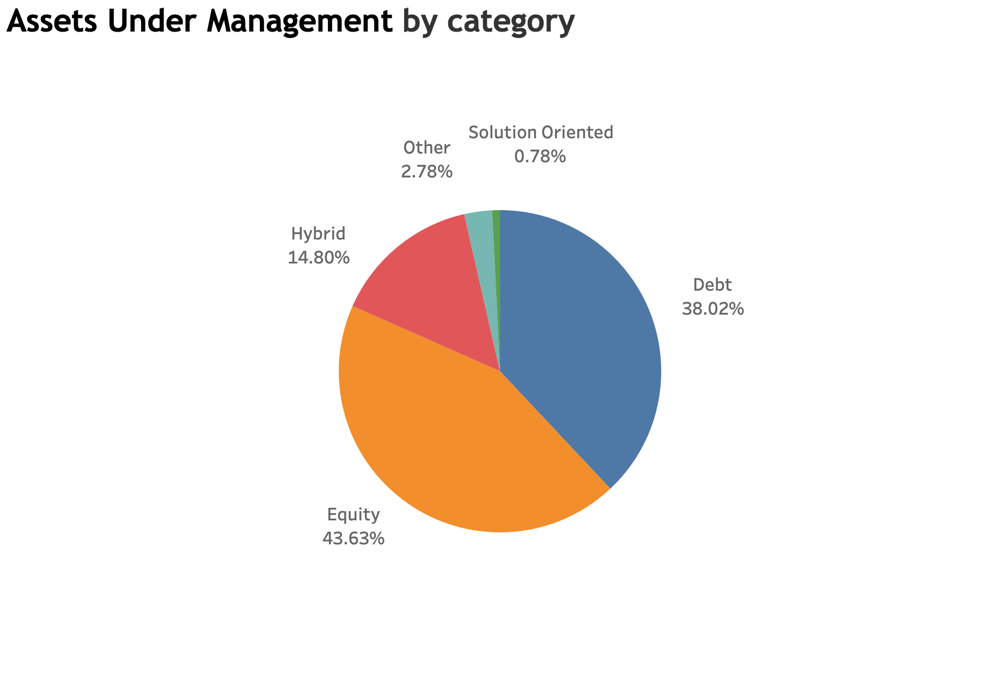

# Indian Mutual Funds Performance Analysis 📈

## 📌 Project Overview
This project is an interactive Tableau dashboard designed to analyze the performance, risk profiles, and market share of Indian Mutual Funds. Built as a capstone application of advanced data visualization techniques, the dashboard provides a comprehensive tool for exploring asset distribution and evaluating the classic risk-versus-reward relationship across various fund categories.

## 📊 Dashboard Navigation
The project features a dedicated landing page with intuitive navigation buttons leading to five specialized analytical views:

1. **Top 10 Funds by Size:** A foundational bar chart visualizing the largest mutual funds by Assets Under Management (AUM).
2. **AUM by Category:** An interactive pie chart breaking down capital distribution across Equity, Debt, and Hybrid funds, serving as a global cross-filter for the dashboard.
3. **Risk vs Return Analysis:** A scatter plot with statistical trend lines demonstrating the correlation between assigned risk levels and 5-year returns.
4. **AMC Market Share:** A packed bubble chart illustrating the dominance of major Asset Management Companies.
5. **Return Distribution:** A box-and-whisker plot detailing the statistical spread, medians, and outliers of returns within each fund category.

## 💡 Key Insights Derived
* **Risk & Reward Correlation:** The regression analysis clearly indicates a positive correlation between higher risk levels (Level 6) and increased 5-year returns, alongside significantly higher volatility.
* **Asset Allocation:** Lower risk tiers (Levels 1-3) are overwhelmingly dominated by Debt funds, offering tight, predictable returns, whereas high-risk tiers are almost exclusively Equity funds.

## 🛠️ Technical Stack & Skills Demonstrated
* **Tool:** Tableau Desktop / Tableau Public
* **Techniques:** Data Preparation, Cross-Filtering, Statistical Regression (Trend Lines), Distribution Analysis (Box Plots), Custom UI/UX Navigation.

## 📁 Repository Contents
* `Indian_Mutual_Funds_Analysis.twbx`: The complete packaged Tableau workbook containing the dashboard layout and local data extract.
* `Images/`: Directory containing project sample screenshots.

---
